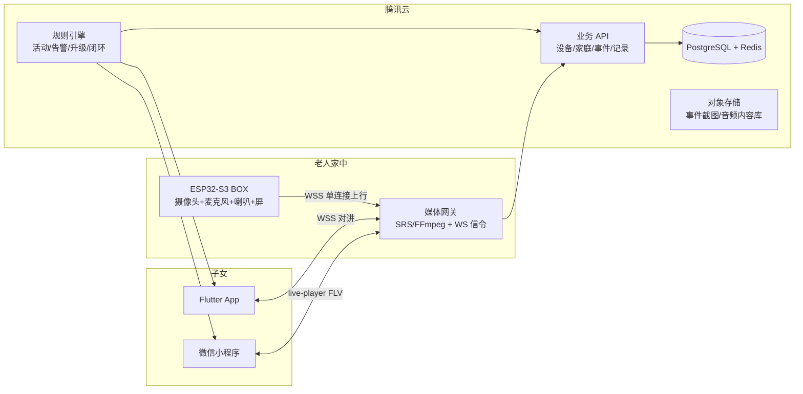

# 实施计划（PLAN）

来源：Cursor 计划文件 `远程看护盒子开发需求文档_e5b9c1b3.plan.md` 的落地版本。
完整需求见 [开发需求文档](开发需求文档.md)。

## 0. 已确认的技术前提

- 硬件：正点原子 ESP32-S3 BOX（ESP32-S3-WROOM-1-N16R8，OV2640 摄像头 + 音频 codec），已用 USB 连接，端口 `COM3`（`USB\VID_303A&PID_1001\MI_02` = USB JTAG/serial debug unit）
- 固件框架：ESP-IDF（官方例程 + ESP-ADF 音频对讲/AEC）
- 服务器：腾讯云 Linux + Docker（可跑 FFmpeg / SRS / Node/Python 服务）
- 客户端：Flutter App（iOS/Android）+ 微信小程序，双端
- 本机现状：Python 3.12.10、git 2.55 已装；ESP-IDF、Arduino、esptool、Espressif 扩展、Node、Flutter 均未安装

**待核实**：ES8388 codec 型号与 BOX 实际芯片（正点原子 BOX 一般为 ES8311 + ES7210）需开箱确认，方案按「ES8311 + ES7210 + ESP-ADF `esp32s3_box` board 配置」写，并留 ES8388 的 I2S 直连适配说明。

## 1. 系统架构

## 2. 固件需求

- 环境配置（**必须写在第一步**）：`CONFIG_ESPTOOLPY_FLASHSIZE_16MB=y`、`CONFIG_SPIRAM_MODE_OCT=y`、`CONFIG_SPIRAM_SPEED_80M`、`CONFIG_SPIRAM_USE_MALLOC`、`CONFIG_SPIRAM_MALLOC_ALWAYSINTERNAL=4096`、`CONFIG_OV2640_SUPPORT=y`、`CONFIG_VIDEO_FB_SIZE_IN_RAW` 等；并写明「不开 PSRAM Octal 会导致摄像头初始化失败」的排查清单
- 任务划分：`cam_task`（帧采集+人形检测）、`audio_task`（I2S 采集/播放）、`net_task`（WS 上行/下行）、`rule_hint_task`（设备侧活动事件）
- 活动检测：摄像头帧差分 + esp-dl 人形检测，输出 `activity` 心跳事件
- 音视频上行：单条 WSS 长连接承载，`WS 帧格式 = magic(2B) | ver(1B) | type(1B) | seq(4B) | ts(8B) | len(4B) | payload`
  - `type=0x01` JPEG 帧（MJPEG，不做 H.264，S3 无硬编）
  - `type=0x02` 老人麦克风音频（G.711 A-law，16k 单声道）
  - `type=0x03` 设备事件（按键求助、屏幕操作、离线原因）
  - `type=0x10` 下行（手机→设备）PCM16 对讲音频；`type=0x11` 下行控制指令
- 音频对讲与回声：ESP-ADF + ESP-SR AEC3，参考信号取扬声器播放缓冲；**v1 交付半双工「按住说话」作为商用兜底**，v2 再上全双工 AEC，全双工列为最高风险项
- 求助按键：物理键短按=求助、长按=取消，另加屏幕确认与撤销
- 屏幕提示：BOX LCD 显示「家人正在查看画面」「家人正在呼叫您」，避免老人受惊
- 可靠性：断网缓存最近 N 帧与事件、心跳 30s、自动重连指数退避、看门狗、OTA 升级通道（后续版本）

## 3. 服务端需求

- 媒体网关：SRS 或 FFmpeg 自建，职责 = 收设备 WS 流 → 写 FLV（`live-player` 播）+ 转 HLS（App 容灾）+ 音频转 AAC/Opus + 分发对讲下行 + 事件抓拍截图
- 业务 API：设备注册/绑定、设备在线状态、家庭与成员、事件列表与确认、查看/对讲会话记录、内容库、订阅消息下发
- 规则引擎（**产品本体，独立模块**）：输入 = 设备活动事件/在线状态/求助事件；输出 = 分级告警 + 升级动作 + 干预内容下发
- 数据模型：`users` / `families` / `family_members`(角色、值班顺序) / `devices` / `device_bindings` / `activity_events` / `alerts` / `alert_actions` / `sessions` / `interventions` / `content_items` / `rule_configs`
- 安全：设备一机一密钥（预共享 + HMAC），全部 wss/https，设备 token 吊销与重置

## 4. 客户端需求

Flutter App 页面：登录/绑定设备 / 首页（今天动了没有、有事没事）/ 实时看画面 / 对讲 / 告警列表与处理 / 内容库（陪练、音乐疗法、疼痛管理）/ 记录与健康周报 / 设置
微信小程序页面：同上精简版，`<live-player>` 播 HTTP-FLV

- 提醒通道：小程序用微信订阅消息（一次性模板，需用户主动授权，设计「开启看护提醒」引导页）；App 用推送 + 短信兜底
- 画面链路：MJPEG 直转不可靠 → 服务器出 FLV（小程序）/ HLS（App）

## 5. 规则引擎规格

| 触发条件 | 级别 | 动作 | 升级 |
| --- | --- | --- | --- |
| 老人按求助键 | L0 | 立即通知全部绑定子女 + App 强提醒 + 发起 60s 呼叫 | 60s 无响应 → L2 呼叫值班电话 |
| 子女发起呼叫 60s 无应答 | L2 | 记录事件、通知次位子女、通知监护人 | 30min 无处理 → L3 |
| 日间(07-22)连续无活动 > 3h | L1 | 推送提醒 + 下发 3 分钟坐姿活动音频 | 6h → L2 |
| 夜间(22-07)连续无活动 > 8h | L1 | 同上 | 跨整夜无活动 → L2 |
| 设备离线 > 10min | L2 | 网络/断电告警，提示检查供电 | 30min → L3 |
| 跌倒/长时间倒地（后续版本） | L1/L2 | 强提醒 + 建议紧急呼叫 | — |

闭环动作（子女端按钮）：已查看并放心 / 已联系老人 / 老人暂时无碍 / 已呼叫急救 / 我来处理（指定人 + 上门/陪诊备注）→ 全部写入 `alert_actions` 与 `sessions`，生成周报

内容干预模块：音乐疗法、久坐干预（坐姿/八段锦音频）、疼痛管理（呼吸放松）三分类内容库；由规则触发推送到设备端播放，并用麦克风 VAD/能量判定老人是否跟随，回写 `interventions` 命中率

## 6. 里程碑与验收

- M0 环境跑通（1-2 天）：ESP-IDF v5.x 安装、`idf.py flash monitor` 打通、PSRAM/Flash 配置核对表
- M1 摄像头局域网页面（2 天）：浏览器访问设备 IP 看到 MJPEG，验收=画面稳定 10 分钟无花屏
- M2 音频对讲（1-2 周）：v1 按住说话可用无啸叫；v2 AEC3 全双工指标（回声抑制 ≥ 20dB，端到端延迟 ≤ 500ms）
- M3 设备上云推流（1 周）：设备 WS 连服务器，服务器 FLV/HLS 可播
- M4 服务端媒体 + 规则引擎（2 周）：规则单测 + 模拟事件回放
- M5 Flutter App（2 周）：首页三件事、看画面、对讲、告警处理闭环
- M6 微信小程序（2 周）：live-player + 订阅消息 + 提醒授权链路
- M7 内容干预与周报（1-2 周）
- M8 单用户试点（持续）：找 1 个真实家庭跑 4 周
- 总计约 3 个月（单人），每个里程碑给可量化验收标准

## 7. 测试计划

设备端（单元+烧录冒烟）、服务端（规则引擎单测/模拟事件回放/压测）、端到端（弱网 3G/丢包 10%/断电恢复）、兼容（Android 8+ / iOS 13+ / 微信 8.x）、安全（一机一密钥、越权访问、密钥重置）、隐私（数据加密、留存期限、删除流程）

## 8. 风险表

全双工 AEC 失败风险（→ 半双工兜底）、微信 live-player 权限与域名备案（→ 提前申请）、MJPEG 外网延迟（→ 缓冲+CDN）、外网带宽成本（→ 码率 256-512kbps、按需拉流）、老人不会用（→ 免操作设计、子女代操作）、单点故障（→ 设备离线告警也算异常）、内容版权（→ 自制音频+合规音乐库）、合规（个人信息保护法、监护知情同意）

## 9. 环境搭建清单

Windows 安装顺序：Python 3.12（已装）→ ESP-IDF v5.3 (espressif install) → VSCode/Cursor Espressif IDF 扩展 → esptool pip 安装 → `idf.py -p COM3 flash monitor` → 后续 Arduino IDE 备用；提供一键配置核对表与常见报错对照（PSRAM 未开 / flash size 错 / 摄像头 init 失败 / COM 口占用 / 分区表溢出）

## 10. 成本估算

腾讯云轻量 4核8G + 对象存储 + 短信/语音 + 微信模板消息（免费）+ 域名与证书备案；带宽按 1080p→VGA 640x480 MJPEG 500kbps 上行估算
