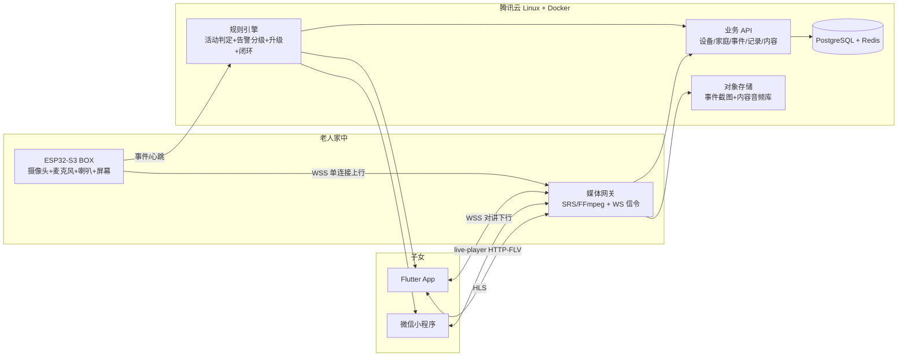
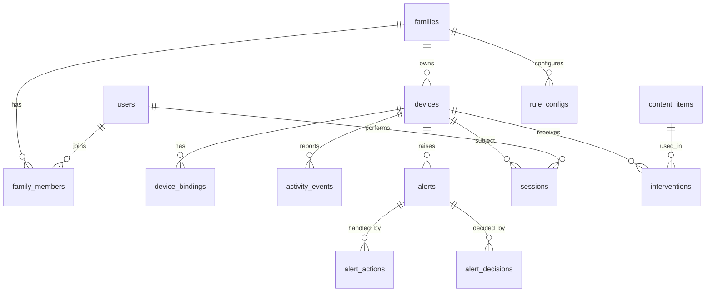

# 远程看护盒子 开发需求文档

> 版本：v1.0　　日期：2026-10-22　　状态：待评审
> 文档负责人：产品/技术负责人（本人）
> 适用范围：正点原子 ESP32-S3 BOX 设备端固件、腾讯云后台、Flutter App、微信小程序

---

## 0. 文档说明

本文档是「远程看护盒子」项目的开发需求文档（PRD + 技术规格）。它同时承担三个角色：

1. **需求说明书**：定义产品在什么场景下、解决什么问题、做到什么程度算完成。
2. **技术规格书**：定义设备端固件、服务端、双端客户端、规则引擎的接口与行为。
3. **排期与验收依据**：每个里程碑给出可量化验收标准，未通过不进入下一阶段。

**本次文档不含代码**。文档评审通过后再按里程碑 M0→M8 实施。

### 0.1 术语表

| 术语 | 含义 |
| --- | --- |
| 设备端 | 放在老人家里的 ESP32-S3 BOX 硬件及其固件 |
| 子女端 | 子女使用的 Flutter App 与微信小程序 |
| 后台 | 腾讯云上的服务端（媒体网关 + 业务 API + 规则引擎） |
| 活动事件 | 设备检测到「屋内有活动」或「长时间无活动」的状态变化事件 |
| 告警 | 规则引擎根据活动/在线/求助事件生成的、分级的、需要人处理的通知 |
| 闭环 | 子女看到告警后做出处置动作并被记录的全过程 |
| 值班链 | 家庭成员按优先级排序的告警通知顺序 |
| 干预 | 设备端主动播放的陪练/音乐/放松类内容 |

---

## 1. 产品定义

### 1.1 一句话

> 买一个现成的摄像头设备，写一个子女端的小程序，定一套「什么时候报警、报警后怎么办」的规则，先卖给一个子女。

### 1.2 目标用户与决策链

- **付费决策人**：老人的子女（30-50 岁，本地或外地，无法常伴父母左右）。
- **决策链**：子女个人即可决策，预算几百元设备 + 每月几十元服务费。**不需要机构采购、不需要招标、不需要写入护理记录、不需要 B 端对接。**
- **使用人**：老人。**老人端零操作**——不要求会用 App、不要求会说话唤醒、不需要按任何按钮。所有交互由子女端发起或后台规则触发。
- **第一用户**：1 个家庭（试点），后续再扩展。

### 1.3 核心价值主张

| 面向 | 说法 |
| --- | --- |
| 子女（对外唯一卖点） | **你不在的时候，出事你会知道。** |
| 老人 | 无需学习、无需操作、无需被打扰（设备端仅有屏幕提示与被动接收） |
| 内部（我们的壁垒） | 后台的活动判断规则 + 内容干预模块 + 闭环数据 |

### 1.4 前台只做三件事

小程序与 App 的首页**只呈现三块内容**，不得堆砌其他指标：

1. **今天动了没有** —— 老人今天是否有走动/起身，最近一次活动时间，距今多久。
2. **有事没事** —— 当前是否有异常：长时间没动、呼叫没回应、按了求助键、设备离线。
3. **点一下就能看** —— 远程打开实时画面，或直接发起语音通话。

音乐疗法、久坐干预、疼痛管理等能力**一律收在后台内容模块**，通过告警提醒推送「陪老人做三分钟坐姿活动」的音频或提示，不在前台作为独立功能板块暴露。

### 1.5 非目标（v1 明确不做）

- 不做机构版、不做护工排班、不做护理记录归档、不做多租户 SaaS 售卖流程。
- 不做跌倒检测的商用级准确率承诺（v2 迭代，v1 仅作「长时间倒地」弱信号）。
- 不做老人端 App、不做老人端语音唤醒。
- 不做医疗诊断级健康结论，只做行为观察与生活干预。

---

## 2. 系统架构

### 2.1 总体架构



### 2.2 数据流

| 流向 | 通道 | 协议 | 说明 |
| --- | --- | --- | --- |
| 设备 → 后台 视频 | 长连接 | WSS，二进制帧 | MJPEG（每帧 JPEG）。S3 无 H.264 硬编码，只能走 MJPEG |
| 设备 → 后台 音频 | 同一条长连接 | WSS，二进制帧 | 老人麦克风，G.711 A-law 16k 单声道（v1），预留 Opus |
| 设备 → 后台 事件 | 同一条长连接 | WSS，二进制帧 | 求助按键、活动心跳、设备状态 |
| 后台 → 设备 控制 | 同一条长连接 | WSS，二进制帧 | 抓拍、开始对讲、播放干预内容、屏幕提示文案 |
| 后台 → 设备 音频 | 同一条长连接 | WSS，二进制帧 | 子女下行语音，PCM16 16k 单声道 |
| 后台 → 子女 画面 | HTTP | FLV / HLS | 小程序用 `live-player` 播 FLV；App 用 HLS（容灾更好） |
| 子女 → 后台 音频 | WSS | WebSocket | 对讲下行到设备，经媒体网关转发 |
| 后台 → 子女 提醒 | HTTPS + 推送 | 微信订阅消息 / App 推送 / 短信 | 见 §5.4 提醒通道策略 |

### 2.3 关键设计原则

1. **规则在云端，设备只做感知**。设备只上报事实（有没有活动、有没有按键、在线与否），所有「算不算异常、通知谁、怎么办」的判断在后台规则引擎。这样规则可 OTA、可迭代、可按家庭配置，且不依赖设备端算力。
2. **单连接承载全部实时数据**。视频、音频、事件、控制共用一条 WSS，避免多端口与 NAT 问题。
3. **免操作设计**。老人端不需要任何主动操作，所有交互入口在子女端或设备屏幕被动提示。
4. **闭环留痕**。每一次告警、每一次查看、每一条处置动作都入库，形成可向用户证明价值的数据（也是后续周报与续费的依据）。

---

## 3. 设备端固件需求（ESP-IDF）

### 3.1 硬件前提

| 项 | 值 | 状态 |
| --- | --- | --- |
| 板卡 | 正点原子 ESP32-S3 BOX（ESP32-S3-WROOM-1-N16R8） | 已到手，USB 已连接 |
| 模组 | ESP32-S3-WROOM-1-N16R8（16MB Flash / 8MB Octal PSRAM） | — |
| 摄像头 | OV2640（DVP 接口） | 需开箱确认排线方向 |
| 音频 codec | **需开箱确认**。正点原子 BOX 通常为 ES8311（编解码）+ ES7210（ADC 阵列）；若为 ES8388 则按 I2S 直连适配 | **待核实** |
| 屏幕 | 2.4 寸 LCD（ILI9341） | 用于被动提示 |
| 端口 | `COM3`，`USB\VID_303A&PID_1001\MI_02`（USB JTAG/serial debug unit） | 已确认 |
| 供电 | USB 供电，常电运行 | — |
| 网络 | 2.4GHz Wi-Fi | — |

### 3.2 固件框架与版本

- **ESP-IDF v5.3.x**（稳定分支），Windows 上通过 `espressif/install` 安装器 + Espressif IDF 扩展。
- 音频能力基于 **ESP-ADF**（Audio Framework）与 **ESP-SR**（AEC3 / NS / VAD）。
- 摄像头与人形检测基于 Espressif 官方 `esp32-camera` 组件与 `esp-dl` 模型。
- 目标芯片配置：`idf.py set-target esp32s3`。

### 3.3 环境配置核对表（**必做，v1 最大坑点**）

必须通过 `idf.py menuconfig` 逐项确认并记录到 checklist（缺任意一项都可能导致摄像头初始化直接失败）：

| 配置项 | 值 | 菜单路径 | 说明 |
| --- | --- | --- | --- |
| `CONFIG_ESPTOOLPY_FLASHSIZE_16MB` | `y` | Serial flasher config → Flash size | 必须 16MB，与 N16R8 一致 |
| `CONFIG_ESPTOOLPY_FLASHSIZE` | `16MB` | 同上 | — |
| `CONFIG_SPIRAM_MODE_OCT` | `y` | Component config → ESP PSRAM | **Octal 模式**，N8R8 是 Octal |
| `CONFIG_SPIRAM_SPEED_80M` | `80M` | 同上 | — |
| `CONFIG_SPIRAM_USE_MALLOC` | `y` | 同上 | 帧缓冲从 PSRAM 分配 |
| `CONFIG_SPIRAM_MALLOC_ALWAYSINTERNAL` | `4096` | 同上 | 内部 RAM 保留 4KB 给中断/音频 |
| `CONFIG_ESP_DEFAULT_CPU_FREQ_MHZ_240` | `240` | Component config → ESP System → CPU 频率 | 跑满 240MHz |
| `CONFIG_ESP32S3_DATA_CACHE_64KB` | `y` | Component config → Cache Config | 打开 PSRAM data cache |
| `CONFIG_OV2640_SUPPORT` | `y` | Component config → Camera Configuration | 摄像头型号 |
| `CONFIG_VIDEO_FB_SIZE_IN_RAW` | 视型号 | 同上 | 帧缓冲尺寸 |
| `CONFIG_ESP32S3_BOX_BOARD`（或对应 board config） | `y` | Component config → Box Support | 官方 BOX 板级配置，含音频/屏幕引脚 |

**排查清单（未开 PSRAM 的典型症状）**：
- `esp_camera_init` 返回 `0x105`（ESP_ERR_NOT_FOUND / 驱动探测失败）且无花屏 → 优先查 PSRAM 是否 Octal 打开。
- 初始化 OK 但 `fb->buf` 为 NULL 或帧全黑/全灰 → 查 `CONFIG_SPIRAM_USE_MALLOC` 与 `CONFIG_SPIRAM_MALLOC_ALWAYSINTERNAL`。
- 出现 `psram not found` / `malloc failed` → 查 `CONFIG_SPIRAM_MODE_OCT` 与模组是否真是 N16R8。
- 编译后刷入报 `flash size` 不匹配 → 查 `CONFIG_ESPTOOLPY_FLASHSIZE_16MB`。
- 摄像头引脚错位/全彩 → 查 board config 与实际排线。

### 3.4 固件任务划分

| 任务 | 职责 | 优先级 |
| --- | --- | --- |
| `cam_task` | OV2640 取帧、缩放、JPEG 编码、帧差分 + 人形检测 | 高 |
| `audio_task` | I2S 采集（老人麦克风）/ 播放（喇叭）+ AEC 参考信号 | 高 |
| `net_task` | WSS 长连接维护、上行打包、下行分发、重连 | 高 |
| `evt_task` | 事件生成（活动心跳、按键、状态变化） | 中 |
| `ui_task` | LCD 被动提示、按键扫描 | 中 |
| `ota_task` | 固件自更新（v2） | 低 |

### 3.5 活动检测规格

- 采样：摄像头出图降采样至 QVGA/VGA，按 2 fps 分析；人形检测用 `esp-dl` 预训练模型（INT8 量化）。
- 输出事件（`type=0x03` 的子类型 `activity`）：
  ```
  { "event":"activity", "human_present":true|false, "motion":true|false,
    "last_active_ts":<epoch_ms>, "score":<float> }
  ```
- 判定规则：连续 N 帧（建议 3 帧）检出人/运动 → 置「有活动」，刷新 `last_active_ts`；连续 M 秒（建议 30s）无任何运动 → 置「静止」。
- 夜间/熄灯场景：画面整体亮度低于阈值时，判为「光线不足」，此时**不判定为无活动**（避免误报），仅记录 `low_light` 标记。
- 设备端只上报事实，**不做超时阈值判断**（阈值属于后台规则，见 §6）。

### 3.6 音视频上行帧格式

单条 WSS 长连接，载荷为二进制帧：

```
magic(2B=0xAA55) | ver(1B=1) | type(1B) | seq(4B, 大端) | ts(8B, ms epoch) | len(4B, 大端) | payload(lenB)
```

| type | 方向 | payload |
| --- | --- | --- |
| `0x01` | 上行 | JPEG 帧（目标 640x480 @ 2-5 fps，按需自适应；单帧 ≤ 40KB） |
| `0x02` | 上行 | 老人麦克风音频，G.711 A-law 16kHz 单声道，20ms 一包（320B） |
| `0x03` | 上行 | JSON 事件（活动心跳、求助按键、屏幕操作、状态变化、错误码） |
| `0x10` | 下行 | 子女端语音，PCM16 16kHz 单声道，20ms 一包（640B） |
| `0x11` | 下行 | JSON 控制指令（抓拍、开始/结束对讲、播放内容、屏幕提示文案、系统时间同步） |

**自适应码率**：网络质量差时，服务器下发 `0x11 {fps:1, quality:30}`，设备降低帧率与 JPEG 质量。

### 3.7 音频对讲与回声消除

- 硬件：ES8311 codec + 扬声器 + 麦克风（若为 ES8388 方案则走 I2S 直连，编解码由软件承担）。
- 参考实现：ESP-ADF 的 `esp_audio` 组件 + ESP-SR 的 AEC3 管线。
- **v1 交付半双工「按住说话」模式**：手机按住按钮 → 下行音频 → 设备播放；松手即停。半双工天然规避啸叫，是可商用的兜底方案。
- **v2 全双工 AEC**：AEC 参考信号取扬声器播放缓冲，指标要求：
  - 回声抑制 ERLE ≥ 20 dB
  - 端到端延迟 ≤ 500 ms（局域网），外网 ≤ 1.5 s
  - 设备侧不得出现可闻啸叫（主观听测 + 频谱检查）
- 附加：NS（降噪）抑制风扇/电视底噪；VAD 用于判断老人是否在说话及干预内容是否被跟随。

### 3.8 求助与屏幕提示

| 事件 | 触发 | 行为 |
| --- | --- | --- |
| 求助 | 物理键**短按** | 立即上报 `help_pressed`，屏幕显示「已通知家人」，10s 内可**长按撤销** |
| 取消 | 长按 | 上报 `help_canceled`，后台关闭该告警 |
| 家人正在看画面 | 收到 `0x11` 指令 | 屏幕显示「家人正在看画面」，5s 后自动熄灭 |
| 家人正在呼叫 | 收到 `0x11` 指令 | 屏幕显示「家人正在呼叫您」，伴随提示音 |
| 干预内容播放 | 收到 `0x11` 指令 | 屏幕显示「该活动一下」等文案 + 播放音频 |

屏幕提示是**防惊吓机制**：老人在不知情下被看到/被听到容易恐慌，所有远程行为都要在设备端有可见提示。

### 3.9 可靠性要求

| 项 | 要求 |
| --- | --- |
| 心跳 | 每 30s 上报一次设备状态（RSSI、IP、运行时长、空闲堆、PSRAM 余量） |
| 重连 | 指数退避 1s→2s→4s…→上限 60s，Wi-Fi 断开后重连并重新入网 |
| 断网缓存 | 缓存最近 N=20 事件与最近 10 帧 JPEG，恢复后补传（补传带 `replay` 标记，规则引擎不因此重复告警） |
| 看门狗 | 任务级看门狗，10s 未喂狗则复位 |
| 异常上报 | 摄像头失效、音频失效、内存不足、低电量（如适用）均上报 `error` 事件并进入降级模式（无摄像头时仍可对讲与求助） |
| OTA | v2 提供双分区 OTA 升级通道，带签名校验与回滚 |

---

## 4. 服务端需求（腾讯云 Linux + Docker）

### 4.1 服务拆分

| 服务 | 技术选型 | 职责 |
| --- | --- | --- |
| 媒体网关 | SRS（主）+ FFmpeg（转码/抓拍兜底） | 收设备 WSS 流、产出 FLV/HLS、转发对讲下行、抓拍截图 |
| 业务 API | FastAPI (Python) 或 NestJS (Node) | 设备注册绑定、在线状态、事件与告警 CRUD、会话记录、内容库、订阅消息下发 |
| 规则引擎 | Python 独立模块 + 定时调度 | 活动判定、告警分级、升级链、闭环统计、内容触发 |
| 存储 | PostgreSQL（业务） + Redis（在线状态/会话/去重） + COS（截图与内容音频） | — |
| 消息 | Redis Stream / RabbitMQ | 设备事件 → 规则引擎 → 通知网关 解耦 |

Docker Compose 编排，单机部署。

### 4.2 媒体网关需求

- 设备接入：WebSocket 端点 `/ws/device`，按设备密钥鉴权。
- 输出流：
  - `http://<domain>/live/<device_id>.flv` —— 供微信小程序 `live-player`。
  - `http://<domain>/live/<device_id>.m3u8` —— 供 App（可切 HLS 增强弱网）。
- 转码：仅做**音频**转码（PCMA → AAC/Opus），视频不转码（保持 MJPEG 直通，省 CPU 与画质损失）。
- 抓拍：收到 `0x11` 抓拍指令时从流中取帧，存 COS，返回 URL。
- 对讲下行：媒体网关接收子女端 WSS 音频，转换后推入设备下行队列；**同一时刻仅允许一路下行会话**（后来的抢占或拒绝）。
- 带宽控制：默认 640x480 @ 3fps、JPEG 质量 60，单路上行约 200-400 kbps；支持按需拉流（无人观看时可降为 1fps 或停止上行省流量）。

### 4.3 业务 API 需求

| 方法 | 路径 | 说明 |
| --- | --- | --- |
| POST | `/api/v1/devices/register` | 设备首次注册（激活码换设备密钥） |
| POST | `/api/v1/devices/bind` | 子女绑定设备到自己的家庭（需老人或已在绑子女确认） |
| GET | `/api/v1/devices/{id}/status` | 在线状态、最近活动、当前告警 |
| GET | `/api/v1/devices/{id}/activity` | 活动历史（今日曲线、最后活动时间） |
| GET | `/api/v1/alerts` | 告警列表（未处理/已处理筛选） |
| POST | `/api/v1/alerts/{id}/actions` | 记录处置动作（闭环） |
| POST | `/api/v1/alerts/{id}/ack` | 子女确认已读 |
| POST | `/api/v1/sessions/watch` | 开启一次查看/对讲会话（生成会话记录） |
| POST | `/api/v1/sessions/{id}/end` | 结束会话 |
| GET | `/api/v1/content` | 内容库（分类分页） |
| POST | `/api/v1/interventions` | 手动触发内容干预 |
| GET | `/api/v1/families/{id}/members` | 家庭成员与值班顺序 |
| PUT | `/api/v1/families/{id}/members/{uid}/order` | 调整值班顺序 |
| GET | `/api/v1/reports/weekly` | 健康行为周报 |

### 4.4 安全与隐私

- 设备一机一密钥：出厂预共享密钥 + HMAC-SHA256 签名，设备不存用户密码。
- 密钥可吊销、可轮换、可重置（重置需子女端二次确认）。
- 全链路 wss/https，媒体网关仅对已授权家庭成员签发短期播放凭证（token 有效期 5 分钟）。
- 家庭隔离：所有 API 按 `family_id` 做数据域校验，禁止跨家庭访问（单元测试覆盖越权用例）。
- 数据留存：视频流不落盘（只做流转发）；事件截图留存 90 天；音频内容由对象存储托管；行为记录留存 1 年。
- 老人及监护人知情同意书为上线前置材料（线下签署）。
- 满足《个人信息保护法》：明确告知用途、最小必要采集、可删除可导出。

---

## 5. 客户端需求（Flutter App + 微信小程序）

### 5.1 双端定位

| 维度 | Flutter App | 微信小程序 |
| --- | --- | --- |
| 定位 | 主推端，功能完整 | 轻量端，子女转发/快速查看友好 |
| 画面 | HLS（`<video>` / `better_player`），弱网可降级 | `<live-player>` 播 HTTP-FLV |
| 对讲 | 原生录音 + WSS 下行 | 需小程序录音权限（`RecorderManager`），受限于后台与权限流程 |
| 提醒 | 厂商推送 + 短信兜底 | 微信订阅消息（一次性模板，需用户主动授权） |
| 登录 | 手机号 + 验证码 | 微信授权登录（openid/unionid） |

双端共用同一套后端 API 与规则引擎；Flutter App 与小程序**共享业务层设计**（同一份接口文档与状态机定义），但实现各自独立。

### 5.2 页面与功能

| 页面 | 核心内容 | 优先级 |
| --- | --- | --- |
| 登录/绑定 | 微信授权或手机号登录；输入设备激活码完成绑定；添加家庭成员 | P0 |
| 首页 | **三块卡片**：今天动了没有 / 有事没事 / 点一下就能看 | P0 |
| 实时画面 | 全屏预览、亮度自适应、截图、切换前后摄像头（若多摄）、画质档位 | P0 |
| 对讲 | 按住说话（v1）/ 全双工开关（v2）、静音、音量、挂断 | P0 |
| 告警列表 | 未处理置顶、级别标识、状态（未读/已确认/已处理）、处置记录 | P0 |
| 告警处置 | 见 §6.4 闭环动作表 | P0 |
| 内容库 | 陪练/音乐疗法/疼痛管理三分类，播放与下发 | P1 |
| 记录与周报 | 活动曲线、告警统计、干预命中率、日/周报导出 | P1 |
| 设置 | 值班顺序、免打扰时段、阈值配置、密钥重置、隐私与授权管理 | P1 |

**首页的严格形态**（避免功能膨胀）：

```
┌─────────────────────────────┐
│  妈妈家 · 在线               │
├─────────────────────────────┤
│ ① 今天动了没有              │
│    最近活动 2小时13分前      │
│    今日活动 6 次 · [看曲线]  │
├─────────────────────────────┤
│ ② 有事没事                  │
│    ✓ 无异常   /  ⚠ 1 条待处理 │
│    [查看]                    │
├─────────────────────────────┤
│ ③ 点一下就能看              │
│    [ 看画面 ]  [ 说话 ]     │
└─────────────────────────────┘
```

### 5.3 交互细节

- 首页数据刷新：进入前台即拉取，后台 30s 轮询；有告警时立即推送刷新。
- 告警强提醒：App 推送 + 弹窗 + 震动；小程序走订阅消息（用户需提前授权一次性模板，**首次进入时必须有「开启看护提醒」引导页**，否则微信不允许推送）。
- 弱网体验：画面加载超过 3s 显示加载态；失败给出「重试/改为低画质/仅听声音」降级选项。
- 无障碍：字号可调（老人相关账号即使不装机也要保证子女端文字清晰）。

### 5.4 提醒通道策略

| 级别 | App | 小程序 | 短信/电话 |
| --- | --- | --- | --- |
| L0 求助 | 推送 + 强弹窗 + 震动 | 订阅消息 | 同时拨打值班电话 |
| L1 活动异常 | 推送 | 订阅消息 | 否 |
| L2 呼叫无应答/设备离线 | 推送 + 弹窗 | 订阅消息 | 短信 + 值班电话 |
| L3 升级 | 推送 + 弹窗 | 订阅消息 | 电话（电话优先于消息） |

---

## 6. 规则引擎规格（产品本体）

> 这是我们真正在卖的东西。设备端与客户端都是载体，**规则才是产品**。

### 6.1 设计原则

1. **可配置**：每个家庭可调阈值、时段、值班顺序、免打扰。
2. **可解释**：每条告警必须能说清「触发了哪条规则、依据什么事实」。
3. **不打扰优先**：宁可少报也不误报；误报一次，子女就会关掉通知。
4. **异常也是异常**：设备离线本身就要告警——很多真实事故的第一信号是「联系不上设备」。
5. **有闭环**：每条告警最终必须落到「已查看/已联系/已处置」的某一种状态，否则产品等于没有承诺。

### 6.2 告警分级

| 级别 | 含义 | 响应要求 |
| --- | --- | --- |
| L0 | 老人主动求助，最高优先级 | 立即通知 + 拨号 |
| L1 | 活动异常（久未活动） | 推送提醒，可延后处理 |
| L2 | 无人响应 / 设备离线 / 长时间无活动 | 通知 + 通知次位 + 升级计时 |
| L3 | 升级告警（长时间未处理） | 电话兜底 + 通知全部成员 |

### 6.3 规则表（默认值，可按家庭覆盖）

| 编号 | 触发条件 | 级别 | 动作 | 升级链 |
| --- | --- | --- | --- | --- |
| R-01 | 老人按下求助键 | L0 | 立即通知全部绑定子女；App 强提醒 + 震动；设备端自动发起 60s 语音呼叫（若无人接听则失败） | 60s 无响应 → L2 呼叫值班电话；30min 无处理 → L3 |
| R-02 | 子女发起呼叫，60s 无应答 | L2 | 记录事件；通知次位子女；生成「呼叫无应答」事件 | 30min 无处理 → L3 |
| R-03 | 日间（07:00-22:00）连续无活动 > 3h | L1 | 推送提醒「今天动得少」+ 下发 3 分钟坐姿活动音频 | 持续 6h → L2 |
| R-04 | 夜间（22:00-07:00）连续无活动 > 8h | L1 | 同上 | 跨整夜无活动 → L2 |
| R-05 | 设备离线 > 10min | L2 | 通知「设备离线，可能是断电/断网」，提示检查供电 | 30min → L3 |
| R-06 | 一天内活动次数 < 2（重度久坐） | L1 | 推送「今天几乎没有活动」+ 下发久坐干预内容 | 无 |
| R-07 | 老人主动呼叫（按键长按 3s 说话） | L0 | 建立与子女的实时对讲，子女端响铃 | 60s 无响应 → L2 |
| R-08 | 检测到长时间倒地姿态（v2） | L1/L2 | 强提醒 + 建议立即联系或呼叫急救 | 立即 L2 |

**抑制与去抖规则**（防止告警风暴）：
- 同一设备同类规则在冷却期内（默认 30min）不重复触发。
- 低光时段（`low_light` 标记）不触发 R-03/R-04。
- 设备重连后的补传事件不触发新的活动类告警。
- 多规则同时命中时，取最高级别，仅推一条合并告警。

### 6.4 闭环动作

子女在告警详情页可执行的动作，全部入库并生成周报：

| 动作 | 含义 | 后续 |
| --- | --- | --- |
| 已查看并放心 | 确认平安 | 关闭告警，计入「误报」候选样本（用于后续调阈值） |
| 已联系老人 | 已通过电话或其他方式确认 | 关闭告警，记录联系时间 |
| 老人暂时无碍 | 老人表示没事（如起夜/午睡） | 关闭告警，**用于阈值自适应**：此类样本降低该规则的敏感度 |
| 已呼叫急救 | 严重事件 | 升级为最高优先级记录，永久留存，不可删除 |
| 我来处理 | 指定某位成员负责 + 备注（上门/陪诊/已买药） | 告警转交，指定人必须响应，否则计时升级 |
| 忽略（误报） | 明确标记误报 | 关闭告警，作为阈值调优样本 |

**未处理告警的自动升级**由后台定时任务执行，与 §6.3 升级链对应。

### 6.5 内容干预模块

三个内容分类（后台内容库，v1 至少各 5 条）：

| 分类 | 目的 | 示例内容 | 时长 |
| --- | --- | --- | --- |
| 音乐疗法 | 情绪调节、缓解孤独 | 舒缓钢琴曲、怀旧老歌、轻音乐 | 10-20 分钟 |
| 久坐干预 | 增加活动量、防久坐 | 坐姿拉伸、肩颈操、八段锦引导 | 3-5 分钟 |
| 疼痛管理 | 缓解老年常见慢性疼痛 | 呼吸放松训练、注意力转移引导 | 5-10 分钟 |

**触发链路**：


**命中判定**：播放期间检测到 3s 以上持续人声/动作声，判为「已跟随」；无响应记为「未响应」，连续 3 次未响应后降低该内容推荐权重并通知内容运营调整。

### 6.6 规则引擎实现要求

- 规则以**声明式配置**（数据库/JSON）定义，代码只写执行器，便于快速迭代。
- 每个规则有独立单元测试；提供**模拟事件回放工具**（输入一段事件序列，输出应触发的告警序列），用于回归。
- 规则引擎与业务 API 解耦，通过消息队列通信，规则崩溃不影响服务可用性。
- 所有告警决策写入 `alert_decisions` 表（可审计：为什么在 14:05 推了这条告警）。

---

## 7. 数据模型



### 7.1 核心表字段

**users**
| 字段 | 类型 | 说明 |
| --- | --- | --- |
| id | bigint PK | — |
| phone | varchar(20) unique | 手机号（App 登录） |
| wx_openid | varchar(64) unique | 微信 openid（小程序登录） |
| wx_unionid | varchar(64) | — |
| nickname | varchar(64) | — |
| created_at | timestamptz | — |

**families**
| 字段 | 类型 | 说明 |
| --- | --- | --- |
| id | bigint PK | — |
| name | varchar(64) | 如「妈妈家」 |
| elder_count | int | 老人数量（v1 固定 1） |
| owner_id | bigint FK | 拥有者（付费人） |

**family_members**
| 字段 | 类型 | 说明 |
| --- | --- | --- |
| family_id | bigint FK | — |
| user_id | bigint FK | — |
| role | enum | `owner`/`primary`/`backup`/`viewer` |
| duty_order | int | **值班顺序**，数字小的先通知 |
| can_trigger_call | bool | 是否有权发起对讲 |
| notify_channels | jsonb | `["push","sms","wechat","voice_call"]` |
| dnd_windows | jsonb | 免打扰时段列表 |
| created_at | timestamptz | — |

**devices**
| 字段 | 类型 | 说明 |
| --- | --- | --- |
| id | bigint PK | — |
| family_id | bigint FK | — |
| sn | varchar(32) unique | 设备序列号 |
| model | varchar(32) | `esp32s3-box` |
| fw_version | varchar(32) | — |
| state | enum | `unbound`/`online`/`offline`/`fault` |
| last_online_ts | timestamptz | — |
| last_active_ts | timestamptz | 最近一次活动时刻 |
| activate_code | varchar(16) | 激活码（绑定用，一次性） |
| created_at | timestamptz | — |

**device_bindings**（设备密钥）
| 字段 | 类型 | 说明 |
| --- | --- | --- |
| id | bigint PK | — |
| device_id | bigint FK | — |
| psk_hash | varchar(128) | 预共享密钥哈希（HMAC 校验用） |
| token | varchar(128) | 当前有效 token |
| rotated_at | timestamptz | 轮换时间 |
| revoked_at | timestamptz nullable | 吊销时间 |

**activity_events**
| 字段 | 类型 | 说明 |
| --- | --- | --- |
| id | bigint PK | — |
| device_id | bigint FK | — |
| ts | timestamptz | 事件时刻 |
| human_present | bool | 是否检测到人形 |
| motion | bool | 是否有运动 |
| low_light | bool | 是否光线不足（不参与异常判定） |
| score | float | 检测置信度 |
| last_active_ts | timestamptz | 上报时的最近活动时间 |
| replay | bool | 是否为断网补传 |
| payload | jsonb | 原始负载 |

**alerts**
| 字段 | 类型 | 说明 |
| --- | --- | --- |
| id | bigint PK | — |
| device_id | bigint FK | — |
| family_id | bigint FK | — |
| rule_id | varchar(16) | 触发的规则编号 |
| level | tinyint | 0/1/2/3 |
| status | enum | `open`/`acked`/`handled`/`escalated`/`closed` |
| title | varchar(128) | 展示标题 |
| detail | jsonb | 触发依据、事实数据 |
| triggered_at | timestamptz | — |
| acked_by / acked_at | bigint / timestamptz | — |
| handled_by / handled_at | bigint / timestamptz | — |
| escalated_at | timestamptz | — |

**alert_actions**（闭环记录）
| 字段 | 类型 | 说明 |
| --- | --- | --- |
| id | bigint PK | — |
| alert_id | bigint FK | — |
| user_id | bigint FK | 操作人 |
| action | enum | `viewed_ok`/`contacted`/`elder_fine`/`called_911`/`i_will_handle`/`ignore` |
| assignee_id | bigint nullable | 「我来处理」指定的负责人 |
| note | text | 备注 |
| created_at | timestamptz | — |

**alert_decisions**（可审计的决策记录）
| 字段 | 类型 | 说明 |
| --- | --- | --- |
| id | bigint PK | — |
| alert_id | bigint FK | — |
| rule_id | varchar(16) | — |
| decision | varchar(32) | `trigger`/`suppress`/`escalate`/`cooldown_skip` |
| reason | text | 为什么触发或被抑制 |
| facts | jsonb | 判定用的事实快照 |
| created_at | timestamptz | — |

**sessions**（查看/对讲记录）
| 字段 | 类型 | 说明 |
| --- | --- | --- |
| id | bigint PK | — |
| device_id | bigint FK | — |
| user_id | bigint FK | 发起人 |
| type | enum | `view`/`talk`/`call_out`/`call_in` |
| started_at / ended_at | timestamptz | — |
| duration_sec | int | — |
| answered | bool | 呼叫是否被接听 |
| peak_latency_ms | int | 峰值延迟 |
| note | text | — |

**content_items**
| 字段 | 类型 | 说明 |
| --- | --- | --- |
| id | bigint PK | — |
| category | enum | `music`/`mobility`/`pain` |
| title | varchar(128) | — |
| audio_url | varchar(512) | COS 地址 |
| duration_sec | int | — |
| tags | jsonb | 适用场景标签 |
| weight | float | 推荐权重（未响应会降权） |
| active | bool | 是否上架 |

**interventions**
| 字段 | 类型 | 说明 |
| --- | --- | --- |
| id | bigint PK | — |
| device_id | bigint FK | — |
| content_id | bigint FK | — |
| trigger_type | enum | `rule`/`manual` |
| trigger_alert_id | bigint FK nullable | — |
| started_at | timestamptz | — |
| followed | bool | 老人是否跟随（VAD 判定） |
| follow_rate | float | 跟随率 |
| note | text | — |

**rule_configs**
| 字段 | 类型 | 说明 |
| --- | --- | --- |
| id | bigint PK | — |
| family_id | bigint FK | — |
| rule_id | varchar(16) | — |
| enabled | bool | — |
| params | jsonb | 阈值、时段、冷却期 |
| updated_by | bigint | — |
| updated_at | timestamptz | — |

---

## 8. 非功能需求

| 类别 | 指标 |
| --- | --- |
| 设备在线率 | ≥ 99%（家庭宽带正常情况下） |
| 画面延迟 | 局域网 ≤ 300ms；公网 ≤ 1.5s |
| 对讲延迟 | 局域网 ≤ 500ms；公网 ≤ 1.5s |
| 告警端到端时延 | 设备事件 → 子女收到提醒 ≤ 3s（L0 ≤ 1.5s） |
| 设备 CPU 占用 | 常态 ≤ 60%，峰值 ≤ 85% |
| 设备内存 | 常态无内存泄漏，连续运行 72h 稳定 |
| 服务端可用性 | ≥ 99.5% |
| 单设备带宽 | 上行 200-400 kbps（可降至 100 kbps 低画质） |
| 100 设备并发 | 单台 4核8G 服务器可承载（媒体网关为瓶颈，需压测验证） |
| 隐私 | 视频不落盘；传输全程加密；数据可导出可删除 |
| 合规 | 个人信息保护法；知情同意；无医疗诊断表述 |

---

## 9. 里程碑与验收标准

| 里程碑 | 周期 | 交付物 | 验收标准（可量化） |
| --- | --- | --- | --- |
| **M0 环境跑通** | 1-2 天 | ESP-IDF 安装、hello_world 烧录、配置核对表 | `idf.py -p COM3 flash monitor` 成功打印日志；§3.3 全部配置项逐条截图确认；`esp_psram_get_size()` 返回 8388608 |
| **M1 摄像头出画面** | 2-3 天 | 局域网 MJPEG 例程 | 电脑浏览器访问 `http://<设备IP>/stream` 稳定出图 30 分钟无花屏/无内存泄漏；帧率 ≥ 5fps（VGA） |
| **M2 音频对讲 v1** | 1 周 | 按住说话链路 | 子女端说话老人能听清；老人说话手机端不啸叫；断网重连后能自动恢复 |
| **M2.5 音频对讲 v2（全双工）** | 1-2 周 | AEC3 | ERLE ≥ 20dB；端到端延迟 ≤ 500ms；连续对讲 10 分钟无啸叫（听测 + 频谱） |
| **M3 设备上云** | 1 周 | 设备 WSS 连服务器 | 服务器收到 MJPEG+音频流；`live/<id>.flv` 可播；断网 5min 恢复后自动重连并补传事件 |
| **M4 服务端 + 规则引擎** | 2 周 | API + 规则引擎 | 规则引擎单测覆盖全部规则与抑制逻辑；模拟回放工具可复现 §6.3 全表；压测 100 设备并发 |
| **M5 Flutter App** | 2 周 | App 主流程 | 首页三块卡片数据正确；看画面稳定；对讲可用；告警处置可闭环并入库；真机 3 台兼容测试通过 |
| **M6 微信小程序** | 2 周 | 小程序主流程 | `live-player` 稳定播放 FLV；对讲可用；订阅消息授权链路走通且能收到；真机 2 台测试通过 |
| **M7 内容干预 + 周报** | 1-2 周 | 内容库 + 干预 + 周报 | 规则可自动触发内容并下发设备播放；VAD 命中判定生效；周报可导出且数据与原始记录一致 |
| **M8 单家庭试点** | 4 周 | 1 个真实家庭 | 连续运行 4 周无崩溃；告警误报率 ≤ 20%；子女周活跃（打开 ≥ 5 天/周）；收集 ≥ 20 条反馈并迭代 1 轮 |

**总计：约 3 个月（单人全职）**。M8 与市场验证并行。

---

## 10. 测试计划

### 10.1 设备端
- 单元测试：帧差分算法、人形判定阈值、帧打包/解包、AEC 参数。
- 冒烟测试：每次烧录后跑 30 分钟稳定性脚本。
- 老化测试：连续运行 72h，记录堆内存曲线、CPU 温度、重启次数。
- 异常测试：拔网线、拔电源、摄像头排线松动、PSRAM 分配失败、外部存储写满。

### 10.2 服务端
- 规则引擎单测：每条规则正向 + 抑制 + 冷却 + 边界值。
- 事件回放回归：固定事件序列 → 期望告警序列，作为 CI 用例。
- API 测试：契约测试 + 越权用例（跨家庭访问必须 403）。
- 压测：设备长连接 100/500 路，SRS 推流 CPU 与带宽。

### 10.3 端到端
- 弱网：3G 限速 300kbps、丢包 10%、延迟 300ms、RTT 抖动。
- 断电恢复：设备断电重启后自动重连并补传事件。
- 客户端：Android 8/10/13、iOS 13/16/18、微信 8.0+。
- 提醒：App 推送到达率、订阅消息到达率、免打扰时段生效。

### 10.4 安全
- 设备密钥伪造、重放攻击、越权访问他人家庭、设备密钥重置流程。
- 媒体 URL 过期验证（过期 token 不可播放）。
- 传输抓包确认全程 TLS。

### 10.5 隐私
- 视频不落盘验证（抓服务器磁盘与 COS 目录）。
- 数据删除与导出流程走通。

---

## 11. 风险与对策

| 编号 | 风险 | 等级 | 影响 | 对策 |
| --- | --- | --- | --- | --- |
| RK-01 | 全双工 AEC 调不好，出现啸叫 | **高** | 对讲不可用 | v1 先交付半双工「按住说话」；AEC 预留为 v2 增量；必要时用独立语音处理模块 |
| RK-02 | 微信 `live-player` 需要直播资质与域名备案 | **高** | 小程序无法播画面 | 提前 2-4 周启动；备用方案：HLS + `<video>`（部分基础库不支持 flv 时回退） |
| RK-03 | 外网延迟飘 | 中 | 体验差 | 服务端加缓冲；FLV 低延迟模式；弱网自动降帧降质；必要时 CDN |
| RK-04 | 带宽成本超预期 | 中 | 毛利被吃 | 按需拉流（无人观看降到 1fps 或暂停）；VGA 码率控制；家庭包月限速 |
| RK-05 | 老人受惊（被偷看） | 中 | 老人反感、拒用 | 设备端屏幕强提示 + 指示灯；子女端查看时设备有明显提示音 |
| RK-06 | 误报过多导致子女关闭通知 | **高** | 留存崩塌 | 规则可配置 + 去抖 + 冷却；「老人暂时无碍」样本做阈值自适应；试点期每周复盘 |
| RK-07 | 设备离线被误当成「平安」 | **高** | 真实事故漏报 | 设备离线独立告警（R-05），且不计入「无异常」 |
| RK-08 | 硬件故障（摄像头/音频） | 中 | 功能退化 | 故障上报 + 降级模式；7×24 监控设备在线率；备件策略 |
| RK-09 | 单人开发进度与范围失控 | **高** | 项目烂尾 | 严格按里程碑推进，M2/M5 之外的功能一律推迟；v1 范围冻结 |
| RK-10 | 内容版权（音乐） | 低 | 法务风险 | 自制内容 + 正版曲库授权；仅使用可商用音乐 |
| RK-11 | 合规（个保法/知情同意） | 中 | 监管与信任风险 | 上线前完成告知同意、隐私政策、数据删除流程 |
| RK-12 | 微信订阅消息一次性限制导致提醒漏发 | 中 | L0 求助漏通知 | L0 兜底走**短信 + 值班电话**，不依赖订阅消息 |
| RK-13 | 云服务器带宽/并发不足 | 中 | 多用户后卡顿 | 单机先压测，瓶颈出现前上多机 + 负载均衡 |

---

## 12. 环境搭建清单（Windows 开发机）

### 12.1 当前状态

| 组件 | 状态 |
| --- | --- |
| Python 3.12.10 | ✅ 已安装 |
| Git 2.55.0 | ✅ 已安装 |
| ESP-IDF | ❌ 未安装 |
| Espressif IDF (VSCode/Cursor) 扩展 | ❌ 未安装 |
| esptool | ❌ 未安装（`pip install esptool`） |
| Node.js | ❌ 未安装（服务端/小程序需要） |
| Docker Desktop | ❓ 待确认（本地调试服务端用） |
| Flutter SDK | ❌ 未安装（App 开发用） |
| 微信开发者工具 | ❌ 未安装（小程序用） |

### 12.2 安装顺序

1. **ESP-IDF**：从 `github.com/espressif/idf-installer` 下载 Windows 安装器 → 安装 v5.3.x → 勾选「全屏安装」（含工具链、Python 环境、驱动）→ 记录 `IDF_PATH`。
2. **Cursor/VSCode 扩展**：安装 Espressif IDF 扩展，指定 IDF 路径与工具链路径。
3. **esptool**：`pip install esptool`（M0 验证串口与 Flash 芯片）。
4. **串口验证**：`esptool.py --chip esp32s3 -p COM3 flash_id`（应识别 16MB Flash 与 8MB PSRAM）。
5. **hello_world**：`idf.py -p COM3 build flash monitor`。
6. **配置核对**：按 §3.3 逐项 menuconfig 并截图存档。
7. **正点原子例程**：拉取正点原子 ESP32-S3 BOX 例程仓库（Camera / Audio / Display 分组），先跑 Camera 例程。
8. **ESP-ADF / ESP-SR**：拉取 adf 与 sr 仓库，编译 BOX 的 audio 例程，确认 AEC 管线可用。
9. **Node.js**（LTS）、**Docker Desktop**、**Flutter SDK**、**微信开发者工具**（按端的需求推进）。

### 12.3 常见报错对照

| 现象 | 原因 | 处理 |
| --- | --- | --- |
| `Camera init failed with error 0x105` | PSRAM 未开或非 Octal | 打开 `CONFIG_SPIRAM_MODE_OCT` / `USE_MALLOC` / `ALWAYSINTERNAL=4096` |
| `esp_camera_init failed: Failed to get frame` | 摄像头供电/排线/引脚 | 检查排线方向、board config、供电 |
| `Flash size mismatch` | flash 配置不是 16MB | `CONFIG_ESPTOOLPY_FLASHSIZE_16MB=y` |
| `PSRAM ID read error` | 模组非 N8R8 / 频率过高 | 降到 40M 验证；确认模组丝印 |
| `Port COM3 in use` | 串口被监视器占用 | 关闭 `idf.py monitor` / Arduino 串口监视器 |
| `A fatal error occurred: Invalid head of stream` | 镜像与芯片不匹配 | `idf.py erase-flash` 后重刷 |
| `guru Meditation` 出现在 audio task | I2S 缓冲不足 / DMA 冲突 | 增大 DMA 缓冲、降低采样率、核对 ES8311 引脚 |
| 编译报 `No such file or directory: sdkconfig` | 未执行 `set-target` | `idf.py set-target esp32s3` |
| 分区表溢出 | 应用过大 | 使用 `partitions.csv` 自定义分区，给 OTA 留双分区空间 |

---

## 13. 成本估算（v1 试点，1 户）

| 项目 | 规格 | 月成本（估） |
| --- | --- | --- |
| 腾讯云轻量服务器 | 4核8G / 带宽 5-10Mbps | ¥80-150 |
| 对象存储 COS | 截图 + 内容音频 < 50GB | ¥5-10 |
| 短信 | 告警兜底，约 20 条/月 | ¥2 |
| 语音呼叫（腾讯云语音通知） | L0/L3 拨号，约 5 次/月 | ¥5 |
| 域名 + SSL 证书 | 1 个域名 | 年费 ¥50-100 |
| 微信订阅消息 | 模板消息 | ¥0 |
| **合计** | — | **约 ¥100-180/月** |

设备侧：ESP32-S3 BOX 硬件成本按批量价 ¥200-400 计（对外售价可定 ¥399-599）。

---

## 14. 试点验证计划（M8）

- 招募：1 个自愿参与的真实家庭（需签署知情同意，明确数据用途与留存期限）。
- 观察期：4 周。
- 每周收集：告警列表（哪些是真异常、哪些是误报）、子女使用频次、老人接受度反馈。
- 关键指标：
  - 告警误报率 ≤ 20%
  - 子女周活跃天数 ≥ 5/7
  - 老人主动使用设备次数 = 0 也能正常用（验证免操作设计）
  - 至少发生 1 次「真实异常被及时发现」的事件（这是产品价值的最强证据）

---

## 15. 待确认事项（Open Issues）

| 编号 | 事项 | 影响 | 负责人 |
| --- | --- | --- | --- |
| OI-01 | 开箱确认音频 codec 型号（ES8311+ES7210 或 ES8388） | 决定音频驱动与 AEC 实现路径 | 硬件 |
| OI-02 | 确认是否已有腾讯云服务器实例及其公网带宽、域名备案状态 | 决定媒体网关部署与小程序域名配置 | 后端 |
| OI-03 | 微信小程序主体（个人/企业）与直播组件权限（`live-player` 属实时音视频类目） | 决定小程序能否播 FLV | 产品 |
| OI-04 | 内容音频自制 vs 采购曲库的版权方案 | 决定内容成本与合规 | 内容 |
| OI-05 | 老人独居还是与子女同住（影响规则默认值与设备数量） | 决定规则参数默认值 | 产品 |
| OI-06 | 商业模式最终形态：一次性买断设备 + 包月服务，或纯服务订阅 | 决定计费与设备归属 | 产品 |
| OI-07 | 服务端技术栈最终选型（FastAPI vs NestJS） | 决定团队一致性 | 后端 |

---

## 附录 A：目录结构约定

```
remote-care-box/
├── docs/
│   ├── 开发需求文档.md              # 本文档
│   ├── 协议说明.md                   # WS 帧格式、REST API 契约
│   ├── 规则配置说明.md               # 规则引擎配置与调试
│   └── 环境搭建checklist.md          # §3.3 + §12 的可勾选清单
├── firmware/                        # ESP-IDF 工程
│   ├── main/                        # 设备端主工程
│   │   ├── components/
│   │   │   ├── camera_capture/      # 取帧 + 编码
│   │   │   ├── activity_detect/     # 人形/运动检测
│   │   │   ├── audio_pipeline/      # I2S + AEC3
│   │   │   ├── ws_uplink/           # WSS 上行/下行
│   │   │   └── device_ui/           # 屏幕提示 + 按键
│   └── sdkconfig.defaults           # §3.3 的配置固化（重要）
├── server/
│   ├── api/                         # 业务 API
│   ├── rule_engine/                 # 规则引擎（执行器 + 配置 + 单测）
│   ├── media/                       # SRS/FFmpeg 配置与编排
│   └── deploy/docker-compose.yml
├── app/                             # Flutter App
├── miniprogram/                     # 微信小程序
└── tools/
    ├── event_replay/                # 事件回放回归工具
    └── firmware_smoke/              # 设备端冒烟与老化脚本
```

## 附录 B：关键决策记录（ADR 摘要）

| 编号 | 决策 | 备选 | 理由 |
| --- | --- | --- | --- |
| ADR-01 | 固件用 ESP-IDF | Arduino | 官方例程、ESP-ADF AEC、PSRAM/Flash 配置可控，量产可维护 |
| ADR-02 | 视频用 MJPEG | H.264 | ESP32-S3 无 H.264 硬编码；MJPEG 实现成本最低，代价是带宽高 |
| ADR-03 | 规则在云端 | 规则在设备端 | 规则是产品本体，必须可迭代、可按家庭配置、可远程更新 |
| ADR-04 | v1 对讲先半双工 | 直接全双工 | 半双工天然无啸叫，先保证商用体验；全双工作为 v2 增量 |
| ADR-05 | 画面经服务器转 FLV/HLS | 设备直连手机 | 跨网可达性、家庭 NAT、手机不需内网穿透 |
| ADR-06 | 双端（Flutter App + 小程序） | 仅 App / 仅小程序 | App 体验完整（对讲、推送），小程序便于子女间转发与轻量查看 |
| ADR-07 | 规则引擎用声明式配置 + 事件回放测试 | 硬编码规则 | 阈值需按家庭调整，误报复盘需要可重放 |

---

*文档结束。变更记录见下。*

| 版本 | 日期 | 变更 | 作者 |
| --- | --- | --- | --- |
| v1.0 | 2026-10-22 | 初版 | 本人 |
